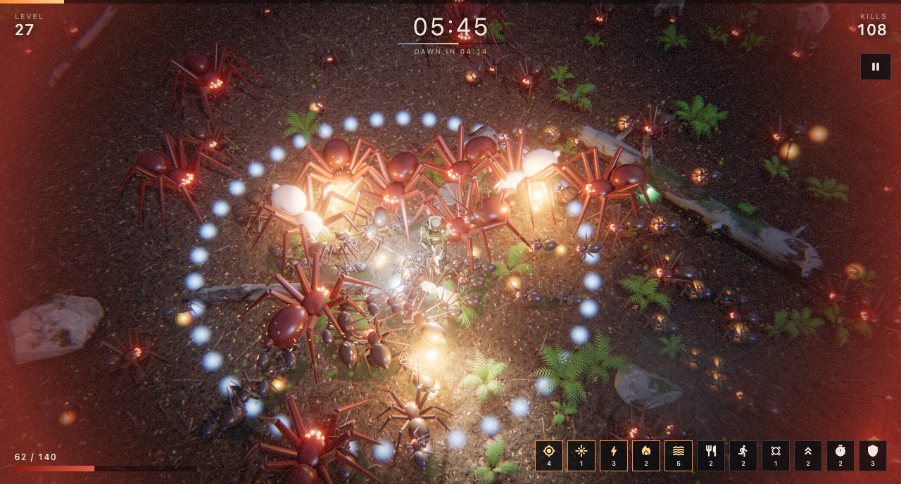

# Emberwatch

A 3D horde-survival game ("bullet heaven") built with Flutter and
[flutter_scene](https://pub.dev/packages/flutter_scene). You hold a moonlit
forest clearing against a spider swarm until dawn. Weapons fire on their own;
you move, collect embers, and pick upgrades.

**[Play it in the browser](https://leehack.github.io/emberwatch/)** (needs
WebGL2; checked in desktop Chrome).



## Run

Requires Flutter 3.47 stable or newer. Flutter GPU is already enabled in the
macOS, iOS and Android runner files; the web build needs nothing extra.

```sh
flutter run -d macos --profile
flutter run -d chrome --profile
flutter run -d <phone or simulator>
flutter test
```

| Platform | Checked on | Result |
| --- | --- | --- |
| macOS | Apple Silicon, profile | 120 fps five minutes into a run; 82 MB release app |
| Web, JavaScript | headless Chrome (WebGL2), release | 60 fps with 275 enemies on screen |
| Web, WebAssembly | headless Chrome (WebGL2), release | 60 fps with the patched engine; about 43 fps with 0.24.3 |
| iOS | iPhone 17 Pro simulator, debug | 60 fps |
| Android | Pixel 9 Pro emulator, profile | Renders correctly over OpenGL ES |

The Android emulator here rasterises on the CPU, so its frame rate says
nothing; no physical phone has run the game yet. Debug builds run at full
speed too.

With the published flutter_scene 0.24.3, the WebAssembly build is the slower
of the two: its WebGL backend copies instance data a byte at a time under
dart2wasm. The live site is built against a patched engine
([bdero/flutter_scene#533](https://github.com/bdero/flutter_scene/pull/533)),
which makes it the faster build (about 4.5 ms of frame work against 6.7 ms for
JavaScript). To reproduce it, point `dependency_overrides` at that branch.

## Controls

| Action | Keyboard | Touch | Gamepad |
| --- | --- | --- | --- |
| Move | WASD / arrows | On-screen stick | Left stick / D-pad |
| Pick an upgrade | 1, 2, 3 or click | Tap | X, A, B (left, middle, right) |
| Pause | Esc / P | Pause button | Start |
| Start, restart, resume | Enter / Space | Tap | A |

Gamepad input has unit tests but has not been tried with a controller.

Phones are locked to landscape. The run pauses when the app loses focus.

## Quality

The title screen cycles three tiers and toggles sound; both are saved, along
with the best time. Phones start on medium (low on the web), desktops on high
(medium on the web).

| Tier | Changes |
| --- | --- |
| High | 2048 px shadows in three cascades with soft edges, ground-truth ambient occlusion, film grain, god rays |
| Medium | 1024 px shadows in two cascades, cheaper ambient occlusion, 80% of the swarm |
| Low | No ambient occlusion or flashlight shadows, 40% of the ferns and branches, 55% of the swarm |

Every tier lets the renderer lower its resolution to hold the frame rate.

## How it is built

| Path | Role |
| --- | --- |
| `lib/game/game.dart` | Owns the scene and the run: phases, leveling, the tick order |
| `lib/game/world.dart` | Ground, scattered props, obstacles, lighting and post-processing |
| `lib/game/swarm.dart` | Enemy simulation and instanced rendering with procedural leg IK |
| `lib/game/arsenal.dart` | Weapons and passive upgrades |
| `lib/game/director.dart` | Spawn pacing across the ten-minute night |
| `lib/game/fx.dart` | Sprites, transient lights, lightning, ground decals |
| `lib/game/embers.dart` | Experience pickups |
| `lib/game/sfx.dart` | Sound effects and ambience |
| `lib/ui/hud*.dart` | HUD and menus, as ordinary Flutter widgets over the 3D view |
| `lib/gamepad.dart` | Controller input |

Every spider is drawn through four instanced meshes (body, eyes, upper legs,
lower legs), and its eight legs are posed each frame by two-bone IK on an
alternating gait. Nothing about the enemies comes from a model file.

## Tools

Every asset is generated by a script in `tool/`; nothing is downloaded.
The generators run in headless Blender (5.2) and are deterministic.

- `blender -b -P tool/gen_surfaces.py -- .` renders the tiling forest-floor
  and bark textures and computes the night-sky environment map.
- `blender -b -P tool/gen_props.py -- .` builds and bakes the rocks,
  boulder, stumps, logs, branches and ferns in `assets/models`.
- `blender -b -P tool/gen_trooper.py -- .` builds the player character, its
  rig and its `Idle`, `Run` and `RunBack` clips.
- `blender -b -P tool/gen_icon.py -- .` draws the app icon and writes every
  size for each platform.
- `tool/synth_audio.py` generates every sound in `assets/audio`.
- `tool/deploy_web.sh [remote]` builds the WebAssembly web app and publishes
  it to the `gh-pages` branch.
- `tool/shoot.sh <dir> <seconds,...> [ENV=value ...]` builds, runs and saves
  frames. `AUTOPLAY=1` drives a bot, `SKIP_TO=<seconds>` jumps into the
  night, `QUALITY=low|medium|high` picks a tier, `CAM_ZOOM`, `DISARM=1` and
  `FORCE=title|levelUp|dead` set up a shot.

The same options work outside release builds on every platform: as URL query
parameters on the web (`?AUTOPLAY=1&SKIP_TO=120`), or compiled in with
`--dart-define=DEBUG_OPTIONS=AUTOPLAY=1,SKIP_TO=120` for phones (a release
build honours only the compiled-in form). A scripted run logs its frame rate
every two seconds.

## Status

A complete, playable ten-minute run, not a finished product. Known gaps:

- No physical phone has run it, so the low and medium tiers are unmeasured
  on real mobile GPUs.
- Gamepad input is unit-tested but untried with a controller.
- Balance and the sound mix have had no human playtest.
- The bundle id `dev.scratch.emberwatch` is a placeholder and no signing is
  configured.

## License

[MIT](LICENSE), for the code and for every generated asset in `assets/`.
